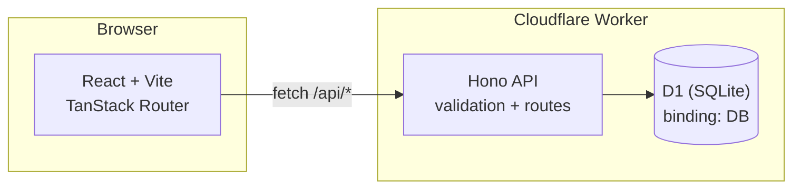
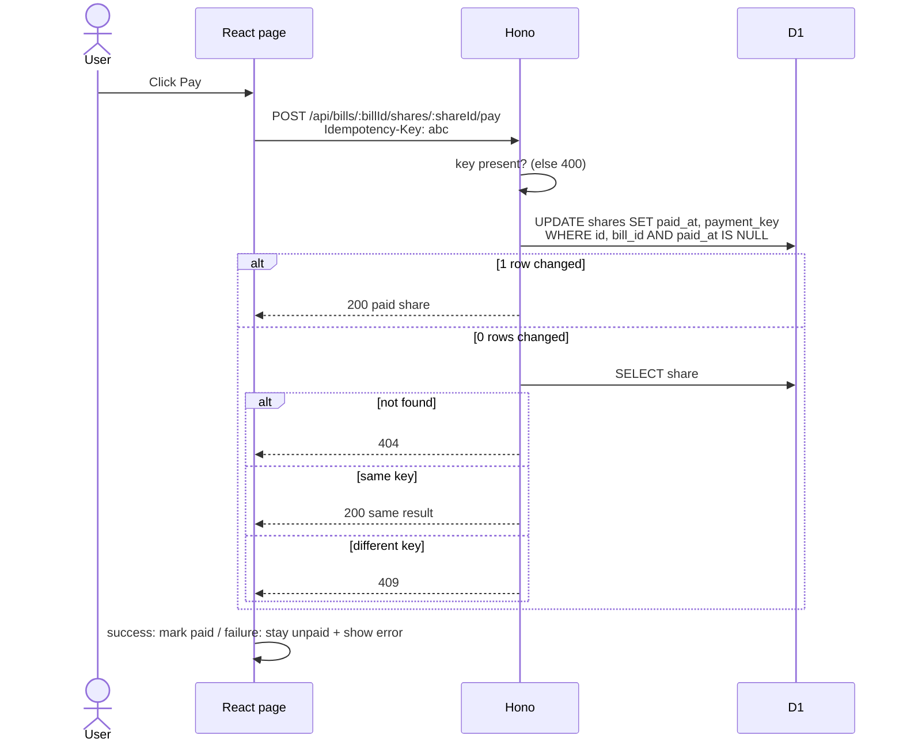
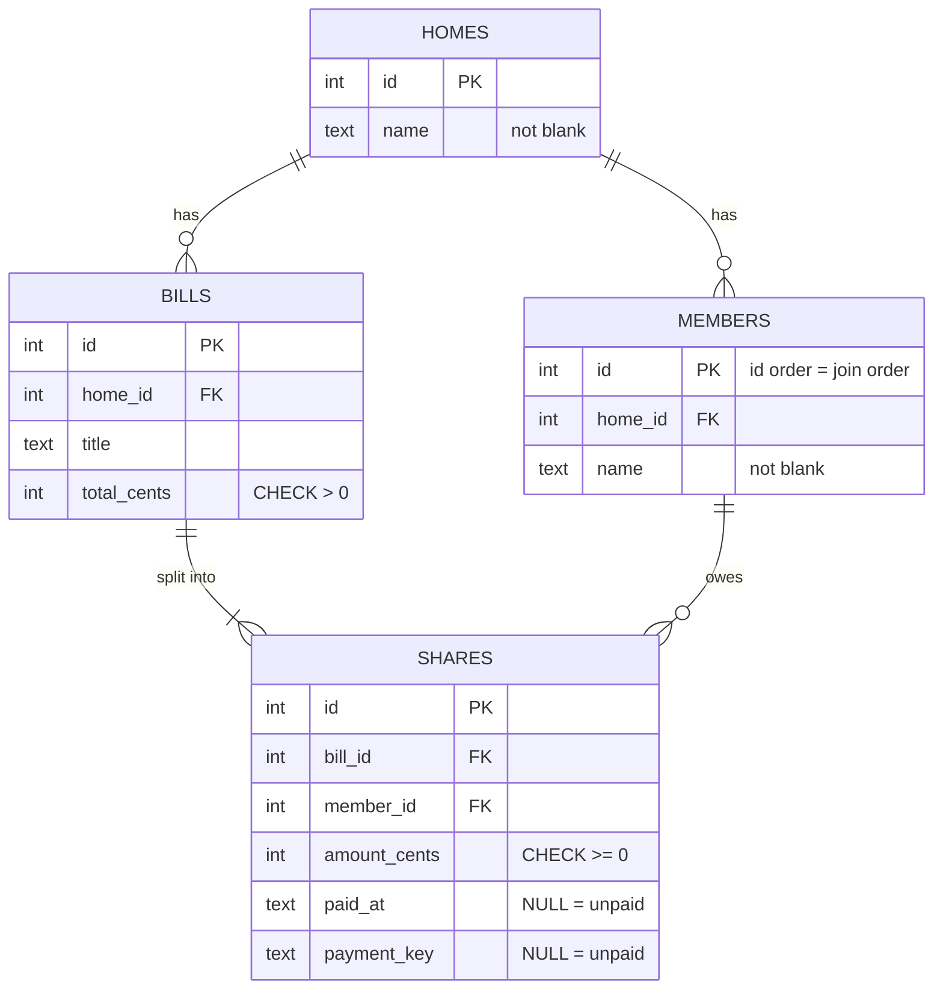

# Shared Bill Splitter: Design

> Small app for flatmates. Create a home, add members, add a bill, split it, let each member pay their share.
> Goal: correct, safe, clear code. Not many features.

---

## 1. Architecture



| Layer      | Choice                                  | Note                                     |
| ---------- | --------------------------------------- | ---------------------------------------- |
| Monorepo   | pnpm workspace (`api`, `web`)           | install once at root                     |
| API        | Hono + TypeScript on Cloudflare Workers | `export default app`, no Node server     |
| Config     | `api/wrangler.jsonc`                    | D1 binding named `DB`                    |
| Database   | Cloudflare D1 (SQLite)                  | schema in `api/migrations/`              |
| Validation | Zod                                     | runtime checks, like Pydantic            |
| Web        | React + Vite + TanStack Router          | data fetching: TanStack Query (optional) |
| Tests      | Vitest in the Workers runtime           | visible + hidden tests                   |
| Quality    | Biome + `tsc` strict, no `any`          | `pnpm check`, `pnpm typecheck`           |

---

## 2. Data flow: paying a share



---

## 3. Current folder structure

This is the starter repository's current layout. `api/migrations/` currently
contains only a placeholder; implementation files should be added when their
step begins.

```
bill-splitter/
├── api/
│   ├── migrations/
│   │   └── .gitkeep
│   ├── src/
│   │   └── index.ts
│   ├── test/
│   │   ├── apply-migrations.ts
│   │   ├── bills.test.ts
│   │   ├── env.d.ts
│   │   ├── helpers.ts
│   │   ├── homes.test.ts
│   │   └── payments.test.ts
│   ├── package.json
│   ├── tsconfig.json
│   ├── vitest.config.ts
│   └── wrangler.jsonc      # D1 binding: DB
├── web/
│   ├── src/
│   │   ├── routes/
│   │   │   ├── __root.tsx
│   │   │   └── index.tsx
│   │   ├── main.tsx
│   │   └── routeTree.gen.ts
│   ├── index.html
│   ├── package.json
│   ├── tsconfig.json
│   └── vite.config.ts
├── biome.json
├── .gitattributes
├── .gitignore
├── design.md
├── INSTRUCTIONS.md
├── package.json
├── pnpm-lock.yaml
├── pnpm-workspace.yaml
└── README.md
```

---

## 4. Database schema

### ER diagram



Rules the diagram shows:

- One home has many members and many bills.
- One bill has one share per member (`UNIQUE (bill_id, member_id)`).
- A share is unpaid while `paid_at` and `payment_key` are both `NULL`.

### SQL

```sql
CREATE TABLE homes (
  id   INTEGER PRIMARY KEY AUTOINCREMENT,
  name TEXT NOT NULL,
  CONSTRAINT ck_homes_name_not_blank CHECK (length(trim(name)) > 0)
);

CREATE TABLE members (
  id      INTEGER PRIMARY KEY AUTOINCREMENT,   -- id order = order added
  home_id INTEGER NOT NULL,
  name    TEXT NOT NULL,
  CONSTRAINT fk_members_home FOREIGN KEY (home_id) REFERENCES homes(id),
  CONSTRAINT ck_members_name_not_blank CHECK (length(trim(name)) > 0)
);

CREATE TABLE bills (
  id          INTEGER PRIMARY KEY AUTOINCREMENT,
  home_id     INTEGER NOT NULL,
  title       TEXT NOT NULL,
  total_cents INTEGER NOT NULL,
  CONSTRAINT fk_bills_home FOREIGN KEY (home_id) REFERENCES homes(id),
  CONSTRAINT ck_bills_total_positive CHECK (total_cents > 0)
);

CREATE TABLE shares (
  id           INTEGER PRIMARY KEY AUTOINCREMENT,
  bill_id      INTEGER NOT NULL,
  member_id    INTEGER NOT NULL,
  amount_cents INTEGER NOT NULL,
  paid_at      TEXT,
  payment_key  TEXT,
  CONSTRAINT fk_shares_bill   FOREIGN KEY (bill_id)   REFERENCES bills(id),
  CONSTRAINT fk_shares_member FOREIGN KEY (member_id) REFERENCES members(id),
  CONSTRAINT uq_shares_bill_member UNIQUE (bill_id, member_id),
  CONSTRAINT ck_shares_amount_nonneg CHECK (amount_cents >= 0),
  CONSTRAINT ck_shares_paid_pair CHECK ((paid_at IS NULL) = (payment_key IS NULL))
);

CREATE INDEX idx_members_home ON members(home_id);
CREATE INDEX idx_bills_home   ON bills(home_id);
CREATE INDEX idx_shares_bill  ON shares(bill_id);
```

### What each constraint stops (for the video)

| Constraint                           | Stops                                                                 |
| ------------------------------------ | --------------------------------------------------------------------- |
| `fk_members_home`, `fk_bills_home`   | Members or bills pointing to a home that doesn't exist                |
| `fk_shares_bill`, `fk_shares_member` | Shares with no bill or no member                                      |
| `ck_bills_total_positive`            | Zero or negative bills, even if the API check is bypassed             |
| `ck_shares_amount_nonneg`            | Negative shares                                                       |
| `uq_shares_bill_member`              | Two shares for one member in one bill (for example a retried request) |
| `ck_shares_paid_pair`                | A share with `paid_at` but no key, or the reverse                     |
| `ck_*_name_not_blank`                | Empty names                                                           |

Open item: check the visible tests for the id type. This design assumes integer ids. If the tests expect strings (UUIDs), change the id columns and keep member order with a separate `created_at` or sequence column.

---

## 5. API

Every error is JSON: `{ "error": "message" }`.

| Endpoint                                                          | Success                                                    | Errors                                                   |
| ----------------------------------------------------------------- | ---------------------------------------------------------- | -------------------------------------------------------- |
| `POST /api/homes` `{ name }`                                      | 201 `{ id, name }`                                         | 422 bad name                                             |
| `POST /api/homes/:homeId/members` `{ name }`                      | 201 `{ id, homeId, name }`                                 | 404 home, 422 bad name                                   |
| `POST /api/homes/:homeId/bills` `{ title, totalCents }`           | 201 `{ id, homeId, title, totalCents, shares[] }`          | 404 home, 422 bad total or no members                    |
| `POST /api/bills/:billId/shares/:shareId/pay` + `Idempotency-Key` | 200 `{ id, memberId, amountCents, paidAt }`                | 400 key missing, 404 bill/share, 409 paid with other key |
| `GET /api/homes/:homeId/balances`                                 | 200 `{ balances: [{ memberId, name, outstandingCents }] }` | 404 home                                                 |
| `GET /api/health`                                                 | 200 `{ status: "ok" }`                                     | none                                                     |

Global handlers: `app.onError` returns 500 JSON. `app.notFound` returns 404 JSON. Bad JSON body returns a JSON 400, never a crash.

---

## 6. Rules and logic

**Split** (pure function, easy to unit test):

```
base  = floor(total / n)
extra = total % n
member i (0-based, in join order) gets base + 1 if i < extra, else base
```

1000 cents / 3 members = 334, 333, 333. The sum always equals `totalCents`.

**Create bill:** check home (404), validate total (422), load members `ORDER BY id` (422 if none), compute shares, insert bill and all shares in **one `DB.batch([...])`** so it is all or nothing.

**Pay:**

1. Missing or empty `Idempotency-Key`: 400.
2. Atomic claim: `UPDATE shares SET paid_at = ?, payment_key = ? WHERE id = ? AND bill_id = ? AND paid_at IS NULL`.
3. If `meta.changes === 1`, return 200.
4. If 0, read the share. Not found: 404. Same key: 200 with the stored result. Different key: 409.

No read-then-write. The `WHERE paid_at IS NULL` makes the database decide the winner, so two requests at once cannot both pay.

**Balances:**

```sql
SELECT m.id, m.name, COALESCE(SUM(s.amount_cents), 0) AS outstanding
FROM members m
LEFT JOIN shares s ON s.member_id = m.id AND s.paid_at IS NULL
WHERE m.home_id = ?
GROUP BY m.id
ORDER BY m.id;
```

`LEFT JOIN` keeps members with no unpaid shares, showing 0.

---

## 7. Test cases (visible + likely hidden)

Visible: `homes.test.ts`, `bills.test.ts`, `payments.test.ts`. Hidden tests go deeper on the cases below.

### Homes and members

| #   | Case                                        | Expected                         |
| --- | ------------------------------------------- | -------------------------------- |
| 1   | Create home with valid name                 | 201 `{ id, name }`               |
| 2   | Name missing, empty, blank, or not a string | 422 (confirm in `homes.test.ts`) |
| 3   | Add member to existing home                 | 201 `{ id, homeId, name }`       |
| 4   | Add member to unknown home                  | 404                              |
| 5   | `homeId` not a number (`abc`)               | 404, not 500                     |
| 6   | Body is not valid JSON                      | JSON error, not a crash          |

### Bills and split

| #   | Case                                                                | Expected                                  |
| --- | ------------------------------------------------------------------- | ----------------------------------------- |
| 7   | Home has no members                                                 | 422                                       |
| 8   | `totalCents` is `0`                                                 | 422                                       |
| 9   | `totalCents` is negative                                            | 422                                       |
| 10  | `totalCents` is `10.5`                                              | 422                                       |
| 11  | `totalCents` is a string `"100"`, `null`, or missing                | 422                                       |
| 12  | `totalCents` is huge, above `Number.MAX_SAFE_INTEGER` or `Infinity` | 422                                       |
| 13  | Even split, 900 / 3                                                 | 300, 300, 300                             |
| 14  | Uneven split, 1000 / 3                                              | 334, 333, 333 in join order               |
| 15  | Total smaller than members, 2 cents / 3 members                     | 1, 1, 0 (sum still 2)                     |
| 16  | 1 member                                                            | One share with the full amount            |
| 17  | Shares sum equals `totalCents`                                      | always                                    |
| 18  | `shares[].paidAt` on creation                                       | `null`                                    |
| 19  | Shares listed in member join order                                  | yes                                       |
| 20  | Member added after a bill exists                                    | no share on the old bill                  |
| 21  | Unknown home                                                        | 404                                       |
| 22  | Bill creation fails halfway                                         | no bill and no shares left behind (batch) |

### Payments

| #   | Case                                     | Expected                                           |
| --- | ---------------------------------------- | -------------------------------------------------- |
| 23  | Pay unpaid share with key                | 200, `paidAt` set                                  |
| 24  | Missing or empty `Idempotency-Key`       | 400                                                |
| 25  | Same key sent twice, same share          | 200 both times, identical body, `paidAt` unchanged |
| 26  | Different key on an already paid share   | 409                                                |
| 27  | Unknown bill                             | 404                                                |
| 28  | Unknown share                            | 404                                                |
| 29  | Share exists but belongs to another bill | 404                                                |
| 30  | Two requests at once, different keys     | one 200, one 409                                   |
| 31  | Two requests at once, same key           | both 200, one payment                              |
| 32  | Same key used on a different share       | pays that share normally (key is per share)        |
| 33  | Non-numeric `billId` or `shareId`        | 404                                                |

### Balances

| #   | Case                        | Expected           |
| --- | --------------------------- | ------------------ |
| 34  | Unknown home                | 404                |
| 35  | Home with members, no bills | every member `0`   |
| 36  | Home with no members        | `{ balances: [] }` |
| 37  | Sum across multiple bills   | correct per member |
| 38  | Paid shares                 | not counted        |
| 39  | Member order                | order added        |
| 40  | Two homes                   | data never mixes   |

### Errors and server

| #   | Case                 | Expected                                               |
| --- | -------------------- | ------------------------------------------------------ |
| 41  | Unknown route        | 404 `{ "error": ... }`                                 |
| 42  | Unexpected exception | 500 `{ "error": ... }`, no stack trace leaked          |
| 43  | Every error response | `Content-Type: application/json` and an `error` string |

---

## 8. Web page (one page)

| State       | Behavior                                                |
| ----------- | ------------------------------------------------------- |
| Loading     | Spinner or skeleton while bills load                    |
| Empty       | "No bills yet" message                                  |
| Error       | Message plus Retry button, no crash                     |
| Slow API    | Pay button disabled and shows "Paying..." while pending |
| Pay success | Share shows paid                                        |
| Pay failure | Share **stays unpaid**, error shown near it             |

Rules: don't mark paid until the API answers 200. Generate one `Idempotency-Key` per click attempt (`crypto.randomUUID()`), and reuse it if the user retries the same attempt. Wrap the page in an error boundary so a bad response can't blank it.

---

## 9. Build order

1. `pnpm install`, run `pnpm test`, confirm the tests fail as expected.
2. `0001_init.sql` migration.
3. Part 1: homes and members. Make `homes.test.ts` pass.
4. `split.ts` pure function, then bills endpoint.
5. Pay endpoint (atomic update + idempotency).
6. Balances.
7. Global `onError` and `notFound`. Check JSON errors everywhere.
8. Web page with all states.
9. `pnpm check && pnpm typecheck && pnpm test && pnpm build`.
10. README "Decisions", video, AI-tools note, submit.

---

## 10. Decisions (draft for README)

| Decision                | Choice                                                    | Why                                                                                                 |
| ----------------------- | --------------------------------------------------------- | --------------------------------------------------------------------------------------------------- |
| Money                   | Integer cents only                                        | Decimals cause rounding errors (`0.1 + 0.2`)                                                        |
| Race on pay             | One conditional `UPDATE ... WHERE paid_at IS NULL`        | The database picks one winner, no read-then-write gap                                               |
| Idempotency             | Key stored on the share                                   | Same key returns the same result, different key returns 409                                         |
| Bill + shares           | `DB.batch`                                                | All or nothing, no half-created bills                                                               |
| Validation              | Zod at the edge, CHECK constraints in the DB              | Two layers: friendly errors plus a safety net                                                       |
| Trade-off for the video | Key stored per share, not in a separate idempotency table | Simpler and enough here. A separate table would be needed if keys had to work across many endpoints |

---

## 11. Submission checklist

- [ ] Public repo from the template
- [ ] `pnpm install && pnpm check && pnpm typecheck && pnpm test` pass
- [ ] Visible tests and `api/test/helpers.ts` unchanged
- [ ] No `any`
- [ ] README has **Decisions** (3)
- [ ] Video 3 minutes or less: architecture, data flow, one trade-off
- [ ] AI tools used and where, written in the form
- [ ] Able to explain every line in a live call
